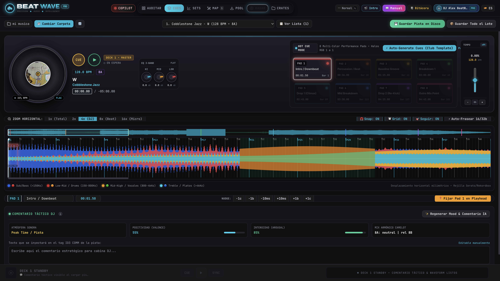
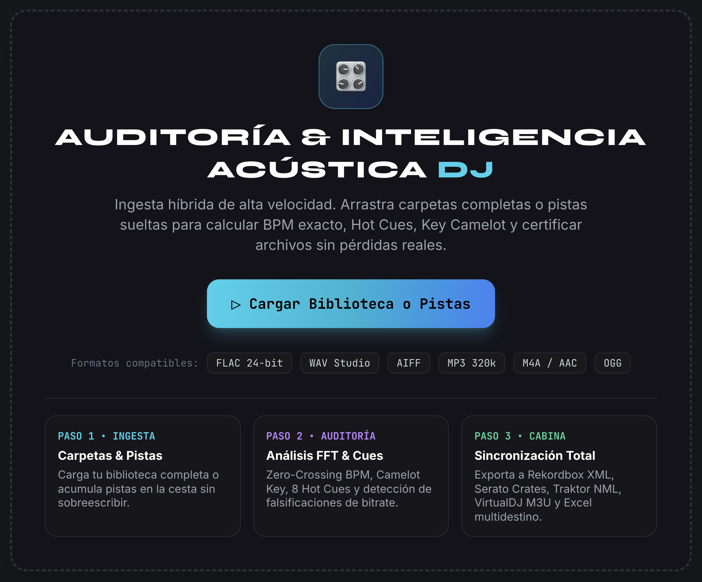
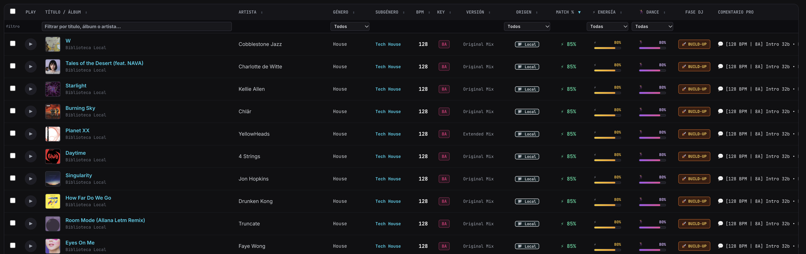
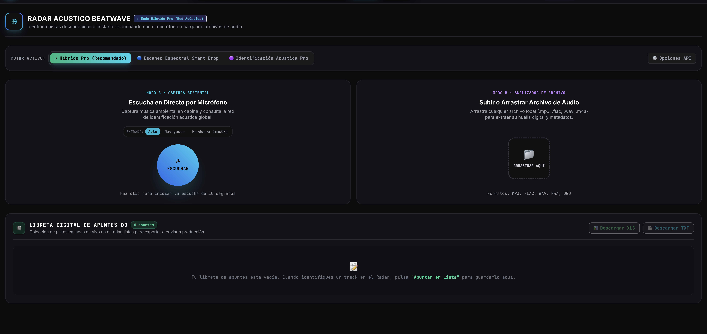
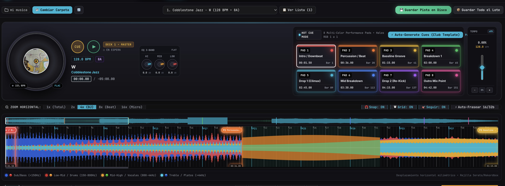

# SPECIFICATION AND UX/UI SPECIFICATION DOCUMENT: DJ COPILOT

## 1. GLOBAL ARCHITECTURE & TECH STACK
- **Frontend:** React 18 using functional components and advanced Hooks (useState, useEffect, useRef, useMemo, useCallback). Styled via Tailwind CSS v3 with a custom night-club color palette (bg-zinc-950, djcyan, djgreen, djred).
- **Bundler:** esbuild, configured to compile to single-file production bundles located at `web/js/app.jsx` and `web/js/copilot.jsx`.
- **Bridge:** Eel framework executing real-time bi-directional communication via local WebSockets. Audio streaming, binary delivery, and REST fallbacks handled through Bottle (Python).
- **Runtime Layout:** Cross-platform Desktop Web App wrapped inside Google Chrome App Mode (`--app=...`).
- **Target Cross-Platform Evolution:** The entire layout must be written in 100% fluid responsive Tailwind classes to easily enable future native compilation to Web, iOS, and Android App Stores using CapacitorJS.

---

## 2. MAIN DASHBOARD VISUAL FRAMEWORK
This layout organizes the application space into three logical interactive columns to completely eliminate user friction and operational fatigue.

---

## 3. MODULAR COMPONENT & FUNCTIONAL BREAKDOWN

### SECTION A: FILE DROPZONE & INGESTION CONTROL
- **Functional Description:** Dedicated zone to ingest local music files, read initial stream wrappers, and manage the background processing execution list.
- **UI Interactive Elements:** Central reactive drag-and-drop container, ingestion queue status tracker, dynamic loader animations, error/corrupt file list.
- **React Components involved:** `<FileDropzone />`, `<IngestionQueue />`, `<ProgressBar />`.
- **Eel / Python Bridge Methods:**
  - `await eel.cargar_pistas_locales(rutas_ficheros)()`: Dispatches selected absolute file paths to the Python thread.
  - `eel.expose(actualizar_progreso_carga)`: Live event listener exposed to Python to stream execution context and progress metadata into React state.

---

### SECTION B: THE SMART CO-PILOT LIBRARY
- **Functional Description:** High-density data grid serving as the decision-making engine for the DJ, evaluating structural track parameters and offering automatic mix compatibility scoring.
- **UI Interactive Elements:** Multi-column sorting header, real-time filtering selectors (+/- 5% BPM boundaries, adjacent Camelot Keys like 4A/5B), matching status badges.
- **React Components involved:** `<TrackGrid />`, `<SortHeader />`, `<CompatibilityBadge />`.
- **Eel / Python Bridge Methods:**
  - `await eel.obtener_lista_analizada()()`: Requests the active processed track matrix collection array from the local database.
  - `await eel.calcular_compatibilidad_mix(track_id)()`: Invokes Python math engine to calculate relative harmonic and timing distances between items.

---

### SECTION C: AUTOMATIC ACOUSTIC IDENTIFICATION & TAG INJECTION
- **Functional Description:** Module tasked with parsing unidentified or poorly formatted audio records via audio fingerprinting and hard-coding standardized database schemas directly into audio metadata wrappers.
- **UI Interactive Elements:** "Acoustic Listen" toggle button, match candidate cards showcasing remote album artwork layers, tag synchronization destination switches (Serato XML Schema vs. Rekordbox Database Structure).
- **React Components involved:** `<FingerprintTrigger />`, `<MetaInspector />`, `<TargetSelector />`.
- **Eel / Python Bridge Methods:**
  - `await eel.identificar_pista_shazam(track_id)()`: Tells Python to generate an audio slice fingerprint and dispatch it asynchronously to the remote recognition API endpoints.
  - `await eel.inyectar_metadatos_dj(track_id, datos_nuevos, software_destino)()`: Invokes Python binary taggers (mutagen/ID3) to rewrite files or modify target app database files locally.

---

### SECTION D: HIGH-PERFORMANCE AUDIO WAVEFORM & CUE EDITOR
- **Functional Description:** Precision tool designed to visualize file structures and allow exact manipulation of rapid playback hot triggers.
- **UI Interactive Elements:** Audio play/pause controls, color-coded 8-button Hot Cue execution grids, individual string label editors for every cue state.
- **Technical Rendering Framework:** Native HTML5 `<canvas>` rendering pipeline communicating directly via 2D Context, processing audio spectrograms at an unthrottled 60 FPS using `requestAnimationFrame` loops to prevent React state cycle drowning.
- **React Components involved:** `<AudioWaveCanvas />`, `<CueGrid />`, `<CueTrigger />`.
- **Eel / Python Bridge Methods:**
  - `await eel.leer_hot_cues_existentes(track_id)()`: Reads external Serato/Rekordbox target files to load positions onto the Canvas view.
  - `await eel.guardar_hot_cue_remoto(track_id, cue_index, posicion_ms, color, nombre)()`: Commits current cue state arrays directly to the physical storage device via Python.

---

## 4. OMNICHANNEL UX/UI REDESIGN DIRECTIVES
Every layout block must abide by the following operational layout constraints:
1. **Adaptive Dual Engine Layout:** Multi-column split grid architecture on Desktop View. Upon transition to CapacitorJS Mobile viewports, hide side panels and condense features into a bottom Tab Navigation bar (Tabs: "Library", "Acoustic", "Cue Editor").
2. **True Low-Light Contrasts:** Strict implementation of pitch-black environments to prevent retinal fatigue in real-world club installations.
3. **Selective Visual Exposure:** Secondary actions must be hidden inside overlay drawers or dropdown menus, leaving only BPM, Key codes, and Mix Match metrics permanently visible to the operator.
